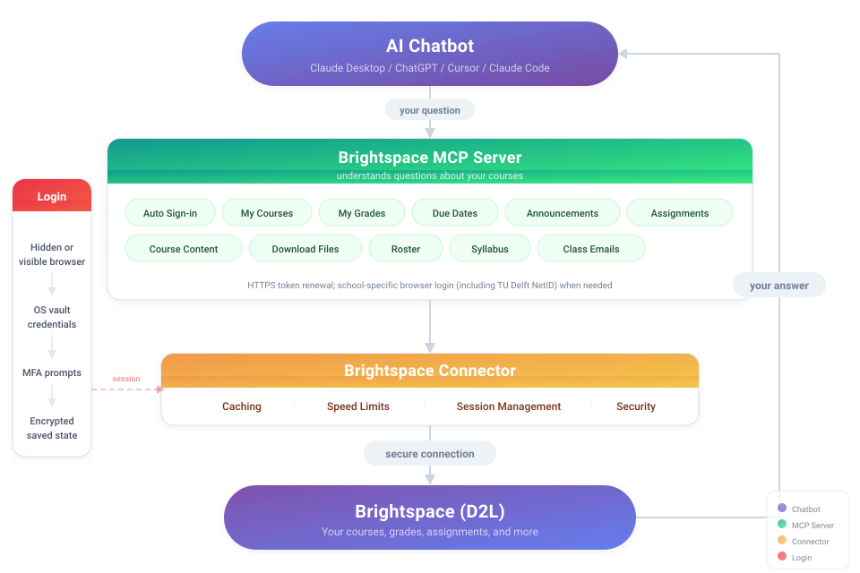

# Brightspace MCP Server

[](https://www.npmjs.com/package/brightspace-mcp-server)
[](https://www.npmjs.com/package/brightspace-mcp-server)
[](https://github.com/RohanMuppa/brightspace-mcp-server/actions/workflows/ci.yml)
[](LICENSE)
[](package.json)

> **By [Rohan Muppa](https://github.com/rohanmuppa), ECE @ Purdue**

Lets your AI see your Brightspace classes, so you can just ask:

> "What's due this week?" · "Am I passing all my classes?" · "Summarize today's announcements" · "Turn my lecture slides into flashcards"

Works with Claude Desktop, Claude Code, Cursor, ChatGPT Desktop, Windsurf, and any other app that supports [MCP](https://modelcontextprotocol.io). It only **reads** your courses. It never submits, edits, or deletes anything.

<p align="center">
  
</p>

## Get started in 3 steps

1. **Install [Node.js](https://nodejs.org/)** version 22 or newer.
2. **Run the setup in a terminal:**
   ```bash
   npx -y brightspace-mcp-server@latest setup
   ```
   It asks for your school's Brightspace address, your username and password, and how you confirm it's you (a phone app, or another way such as a text message). Your password goes into your computer's password store (Keychain on Mac, Credential Manager on Windows), never into a file. Setup also connects the server to Claude Desktop, Cursor, Antigravity, Codex, or Claude Code if you have them. If one already has a `brightspace` entry pointing somewhere else, setup asks before replacing it.

   If your school is in the table below, add its flag (such as `--purdue`) to skip typing the address.

   **On a Mac:** when Keychain asks whether `node` may use the saved Brightspace password, choose **Always Allow**, not just Allow.
3. **Restart your AI app and ask it something.** The first question signs you in. If your phone asks you to approve a sign-in, approve it and ask again.

**Rather have the AI install it?** Paste this into Claude Code, Cursor, Windsurf, Copilot, or Codex:

```
Install brightspace-mcp-server for me by following
https://github.com/RohanMuppa/brightspace-mcp-server/blob/main/LLMs.md
(use --purdue at Purdue, --suny at SUNY, --tudelft at TU Delft, --cuny at CUNY, --leiden at Leiden, --mcgill at McGill, --mun at Memorial University, --ngeeann at Ngee Ann Polytechnic, or --javeriana at Javeriana Cali).
```

The AI does everything it can by itself, then gives you one terminal command. That command asks for your password and waits for you to approve the sign-in on your phone. That's the only part that needs you. Afterwards the AI checks that it can see your courses.

Using a different AI app? Add the command `npx -y brightspace-mcp-server@latest` to its MCP settings (on Windows: `cmd /c npx -y brightspace-mcp-server@latest`). Codex and Claude Code commands, and general steps, are in [docs/troubleshooting.md](docs/troubleshooting.md).

## Does my school work?

If your school uses D2L Brightspace, yes. These have automatic sign-in built in:

| School | Sign-in | Flag |
|--------|---------|------|
| Purdue | Microsoft (phone approval, authenticator code, or browser) | `--purdue` |
| SUNY | Shared site with a campus picker | `--suny` |
| Western University | Microsoft | `--western` |
| TU Delft | NetID (no two-factor) | `--tudelft` |
| CUNY | CUNY Login, authenticator code each time | `--cuny` |
| Leiden University | SURFconext → Microsoft | `--leiden` |
| McGill University | Microsoft Entra | `--mcgill` |
| Memorial University of Newfoundland | MUN Login (CAS, no two-factor when tested) | `--mun` |
| Javeriana Cali | OneGate (password + authenticator code) | `--javeriana` |
| Ngee Ann Polytechnic | Microsoft Entra | `--ngeeann` |
| Any other D2L school | Paste your Brightspace address at setup. If the sign-in page isn't recognized, answer 2 to setup's sign-in question to finish it by hand | none |

School-specific quirks are in [docs/sign-in.md](docs/sign-in.md#per-school-notes).

## Things to ask

| About | Try |
|-------|-----|
| Grades | "Am I passing all my classes?" · "Compare my grades across courses" · "Is there feedback on my midterm?" (quiz feedback often can't be read through the API, so the answer links to the quiz instead) |
| Due dates | "What's due in the next 48 hours?" · "Build me a study schedule for the week" |
| Assignments and rubrics | "What does the lab 4 spec actually ask for?" · "Why did I lose points on the analysis criterion?" · "Did I turn in HW 3?" |
| Quizzes and exams | "Which quizzes close this week?" · "Is there a midterm in the gradebook that isn't on my assignments list?" |
| Announcements | "Did any professor post something important today?" · "Read the file attached to today's announcement" |
| Course content | "Find the midterm review slides" · "Download every PDF from Module 5" · "Save this whole course to a folder on my computer" · "Search this course for office hours" · or read a file inline instead of saving it |
| Syllabus | "What's the late policy in ECE 264's syllabus?" (if the syllabus lives in an external tool, you get the link to open instead) |
| People | "Who are the TAs for ECE 264?" · "Who is in my project group?" |
| Discussions | "Summarize the latest posts in the final project thread" |
| Lecture videos | "What did the professor say about pinch-off in Tuesday's recording?" (Kaltura and YouTube. If YouTube asks for a sign-in or "not a bot" check, the answer gives the link: open it, choose "Show transcript", and paste that text here) |
| Calendar | "When is my midterm?" · "Is lab cancelled on Thursday?" |
| Instructors and TAs | "Which students haven't submitted Lab 4 yet?" (students see "Instructor or TA access required" for these) |

If Brightspace hides part of the data, such as a submission, quiz attempts, or part of the quiz list, the answer says "unknown" or "incomplete" rather than "missing" or "complete". Full tool reference: [LLMs.md](LLMs.md).

## Download a whole course

Ask your assistant to save a course, or run it yourself from a terminal:

```bash
npx -y brightspace-mcp-server@latest sync --course 123456 --dest ~/Courses/ECE-264
```

Every file in the course's Content area is saved into folders named after its modules. Running it again fetches only what is new.

| Option | What it does |
|--------|--------------|
| `--existing skip\|replace\|keep_both` | A file already there: `skip` (default) leaves it, `replace` re-downloads only files the sync saved and you haven't edited, `keep_both` saves a different copy as `name (1).ext` |
| `--module <id>` | Only that module and the modules inside it |
| `--dry-run` | List what would be downloaded, and download nothing |
| `--max-files <n>` | Most files per run (default 300). Run it again to continue |
| `--json` | Print the result as JSON on stdout, for scripts |
| `--notify` | macOS notification when new files arrive or the sign-in has expired; quiet when nothing changed |

- The sync keeps a `.brightspace-sync.json` manifest in the folder, which is how it knows which files are its own. Only one sync runs in a folder at a time. If a crashed run left its `.brightspace-sync.lock` behind, the next run takes it over.
- Course names are made safe for your computer, and a course can't create dotfiles such as `.zshrc` in your folder.
- Each run is capped at 300 files and 5 GB. The assistant's version also stops cleanly after 8 minutes. Ask it again to continue. Ctrl-C stops the CLI cleanly (exit 130) with no partial file left behind.
- Exit codes: 0 when everything was done, 1 if a file failed or wasn't attempted (including a sign-in that expired partway; saved files are kept), 2 for a usage error. Links and embedded videos aren't files, so the result counts them separately rather than as missing downloads.

**Some folders are refused.** Downloads can't go to your home folder itself, a drive root, a hidden (dot) folder such as `~/.ssh`, `~/Library` (except cloud-drive and iCloud folders), system folders such as `/etc` or `/System`, or on Windows `Windows`, `Program Files`, `ProgramData` and `AppData`. Anything else is fine, including `/tmp`, external drives and `~/Documents`. Choose a folder like `~/Documents/Brightspace`; the refusal names the rule. The same rule applies to `download_file`, `get_syllabus` and every other tool that saves to disk. The person running the server can allow a folder anyway with `D2L_DOWNLOAD_ROOTS` (see [Settings](#settings-you-might-want)). Full rules: [LLMs.md](LLMs.md).

**Notifications and a daily schedule (macOS).** Sign-in approval numbers ("Approve 91 in Microsoft Authenticator") and `sync --notify` results show as system notifications; `D2L_NOTIFY=0` turns them off. To sync every day: `brightspace-mcp-server schedule --course 123456 --dest ~/Courses/ECE-264 --at 08:00` (also `schedule --list` and `schedule --remove --course 123456`). Details: [LLMs.md](LLMs.md).

## Prompts

Apps with a prompt picker (like Claude Desktop) also offer four one-click prompts:

- `weekly_briefing`: a 7-day rollup of what's due, what's new, and what changed in your grades
- `grade_audit` (optional `courseId`): flags missing or low-scoring items
- `study_planner` (optional `daysAhead`, default 7): plans study time from due dates and calendar events
- `course_summary` (required `courseId`): syllabus, outline, assignments and grades for one course

## When it asks you to sign in

There's no separate login. Asking a question signs you in, and it stays signed in on its own most days. When your school wants two-factor again, the number to approve shows up in the answer. Approve it on your phone, and the assistant keeps checking, so the original question completes as soon as sign-in does. If it gets stuck, run this in a terminal:

```bash
npx -y brightspace-mcp-server@latest auth
```

How often your school asks for two-factor is up to the school, not this tool.

**On a Mac,** a one-time **Allow** at the Keychain prompt can make later sign-ins from your AI app or another terminal fail or hang. Pick **Always Allow** instead. That permission only lets the local Brightspace server read its own saved sign-in password, nothing else in your Keychain.

**Want fewer 2FA prompts?** `setup` asks **How often do you want to approve sign-ins on your phone?** Pick **1** every time (the default), **2** to remember this computer, or **3** to let it answer Microsoft's code requests (needs an authenticator setup key). Options 2 and 3 are not for shared computers. Steps and tradeoffs: [docs/sign-in.md](docs/sign-in.md#fewer-2fa-prompts).

**To sign in** from a chat, ask your AI app to sign you in to Brightspace. It can start the sign-in itself, and opens a window for you when no password is saved.

**To sign out early** (on a shared computer, say), ask your AI app to sign you out of Brightspace, or run `npx -y brightspace-mcp-server@latest auth --logout`. This deletes this computer's saved session, so the next question does a full sign-in. Your password and authenticator key are kept. It doesn't sign you out of Microsoft or Brightspace elsewhere. On a shared computer, also delete the saved `brightspace-mcp-server` entries from Keychain Access (Mac) or Credential Manager (Windows). Details: [docs/sign-in.md](docs/sign-in.md#signing-out-early).

Duo, authenticator codes, visible-browser mode, and running without a browser at all (Docker, WSL, hardware keys) are covered in [docs/sign-in.md](docs/sign-in.md).

## Settings you might want

All optional. Set them in your AI app's MCP `env` config or in your shell. The full list is in [LLMs.md](LLMs.md#environment-variables).

| Setting | What it does |
|---------|--------------|
| `D2L_REMEMBER_MFA=true` | Tick Microsoft's "Don't ask again" box so later sign-ins skip the second factor. Off by default, and not for shared computers. `setup` option 2 saves the same choice |
| `D2L_TOTP_SECRET` | An authenticator setup key, so a Microsoft code challenge is answered on this computer. Prefer `setup` option 3, which keeps the key in your OS keychain. Environment only for CI and containers: anything that can read the environment gets your second factor ([details](docs/sign-in.md#fewer-2fa-prompts)) |
| `D2L_HEADLESS=false` | Show the browser window during sign-in, for MFA methods that need a click |
| `D2L_DUO_PASSCODE=1` | On Duo, type a passcode instead of waiting for a push |
| `D2L_SESSION_COOKIE` / `D2L_ACCESS_TOKEN` | Skip the browser entirely with a pasted cookie or token. See [docs/sign-in.md](docs/sign-in.md#no-browser-paste-a-session-cookie-or-token) |
| `D2L_INCLUDE_COURSES` / `D2L_EXCLUDE_COURSES` | Comma-separated course ids to show or hide |
| `D2L_ACTIVE_ONLY=false` | Include courses whose enrollment has ended |
| `D2L_CURRENT_ONLY=true` | Only show courses in their current enrollment window (Brightspace's "Current Courses" widget) |
| `D2L_DOWNLOAD_ROOTS=/data:/srv/courses` | Folders downloads may always use, even where the refusals above say no. Separate paths with `:` on macOS and Linux, `;` on Windows. Only the person running the server can set it |
| `D2L_NO_UPDATE_CHECK=1` | Turn off the new-version notice |
| `D2L_DEV_MODE=true` | Write a local, content-free log of tool calls and sign-in events, for debugging ([how](docs/dev-mode.md)) |

## One server for all your chats

Every chat shares one Brightspace server automatically, with one sign-in, one session and one cache. Closing a chat never interrupts another. Codex users, or anyone who wants to run one server themselves, can follow [docs/shared-server.md](docs/shared-server.md).

## Privacy and security

Your password is stored in your computer's password store, never in a plaintext file. Saved session state is encrypted with AES-256-GCM. Approvals (the tap or number) stay on your phone, and the server never sees them. A code you type, or one generated from a saved authenticator key, goes only to the sign-in page. None of the tools submit, edit or delete anything in your courses. More detail: [docs/sign-in.md](docs/sign-in.md#whats-stored-where).

## Something not working?

- Run `npx -y brightspace-mcp-server@latest doctor` first. It checks the whole setup and tells you what to fix. For a global install, use `brightspace-mcp-server doctor`.
- **Browser removed** (say, by a disk cleaner): sign-in restores it once by itself. To do it now, run `npx -y brightspace-mcp-server@latest repair`. It doesn't sign in or change your AI apps.
- **`npx` fails with `EPERM` on a Mac:** run it from your home folder. macOS blocks `npx` from Documents, Desktop and Downloads unless you grant Files and Folders access.
- **`Authentication failed: The native credential store is locked or unavailable.`** Unlock your password store (on a Mac, log in or unlock Keychain Access), run `npx -y brightspace-mcp-server@latest auth` again (or `setup` if that still fails), and choose **Always Allow** when Keychain asks.
- **Works in a terminal but not in the app:** the app starts the server separately and may not see your password store yet.
- **The app says the server timed out while starting:** see the startup notes in [docs/troubleshooting.md](docs/troubleshooting.md).
- **Which version do I have?** Ask your AI "which version of the Brightspace server am I running?"
- **Anything else:** see [docs/troubleshooting.md](docs/troubleshooting.md).
- **Still stuck?** [Open an issue](https://github.com/RohanMuppa/brightspace-mcp-server/issues) and paste what the terminal printed.

## For developers

Tool reference, response fields, environment variables and the codebase map: [LLMs.md](LLMs.md). What's safe to build against: [STABILITY.md](STABILITY.md).

## License

MIT. See [LICENSE](LICENSE).
